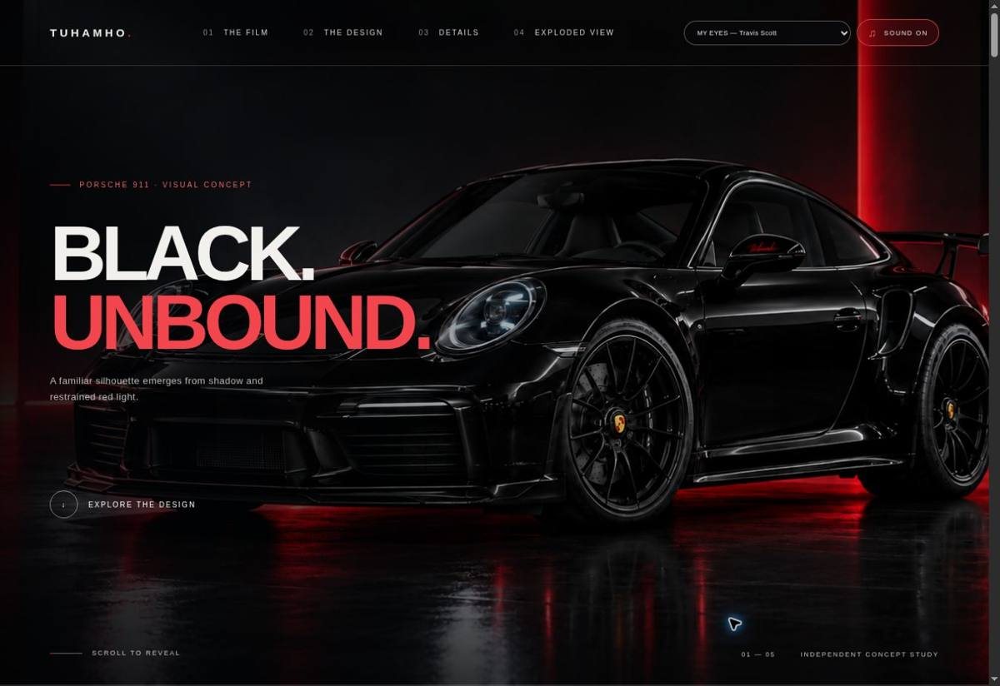
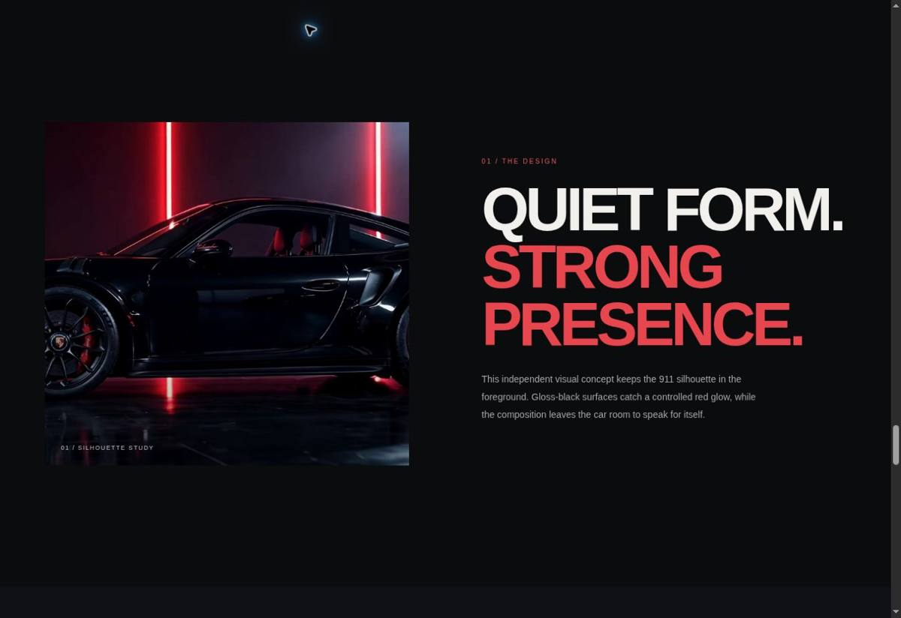
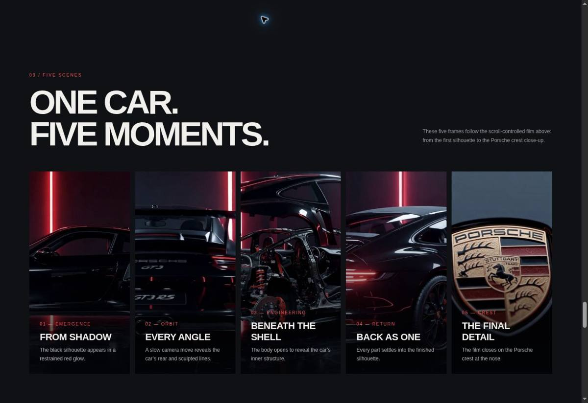
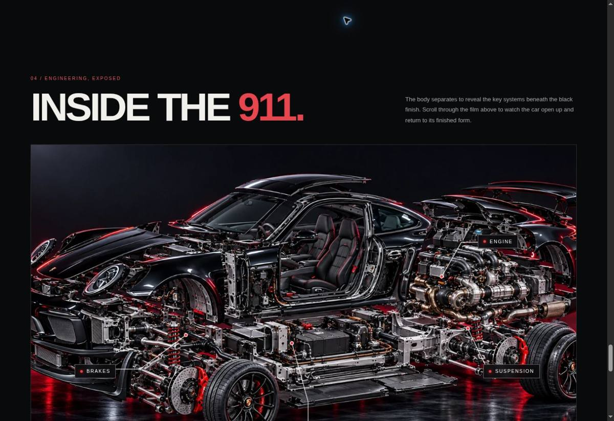

# TUHAMHO — 911 Black

A cinematic, scroll-controlled Porsche 911 visual concept. The page pairs a black 911, restrained red studio lighting, a five-part film, and an annotated exploded-view illustration.

**Live website:** [tuhamho-porsche-vercel.vercel.app](https://tuhamho-porsche-vercel.vercel.app/)  
**Repository:** [tuhamho-dreamcar-911](https://github.com/tuhamho/tuhamho-dreamcar-911)

> Independent visual concept project. Not affiliated with, endorsed by, or an official product of Porsche AG. The exploded view is illustrative, not a factory service diagram.

## Website preview

### Opening film — “Black. Unbound.”


### Design study


### Five moments
The scroll-controlled film moves through emergence, orbit, engineering, reassembly, and a final Porsche crest close-up. The page also presents the five moments as a visual gallery.



### Engineering / exploded view
The illustrated car separates into major systems, with callouts for the engine, chassis, suspension, and brakes.



## What’s on the site

- A full-screen film whose playback position follows the page scroll.
- Five cinematic sequences, from the first silhouette through the final crest close-up.
- A design section and a gallery describing each moment.
- An illustrative exploded view with four major system callouts.
- A selectable background-music playlist.

## Run locally

The repository stores large media assets as ordered binary chunks. Rebuild them and prepare the static site with:

```bash
bash scripts/build.sh
```

This creates the `dist/` directory. Serve that directory with any static web server to preview the site locally.

## Deploy to Vercel

Import this repository into Vercel. The included `vercel.json` runs `bash scripts/build.sh` and publishes `dist/`.

Browsers generally require a user gesture before they allow audible autoplay. Use the sound control in the top navigation if playback is muted.

## Credits and scope

This is an independent fan-made visual concept for TUHAMHO. Porsche, 911, and related marks belong to their respective owners. No factory specifications or service instructions are represented here.
